# FairStock — Stream Analytics

**Real-time demand-pressure detection for adaptive flash-sale inventory reservations.**

This repository contains the **Java / Apache Flink** analytics pipeline for FairStock. It consumes reservation lifecycle events from Apache Kafka, aggregates demand by product in processing-time windows, classifies inventory pressure, and publishes signals that the .NET reservation backend can use to adjust reservation policies.

> Companion repository: [`fairstock-reservation-service`](../fairstock-reservation-service) — .NET backend. Replace this relative link with your GitHub URL if the repositories are hosted separately.

## Problem

During flash sales, demand can change within seconds. Static reservation durations do not account for a sudden spike in requests or a growing rejection rate. FairStock's analytics service continuously derives **LOW, MEDIUM, or HIGH demand pressure** from the event stream, enabling the backend to respond with shorter or longer reservation policies.

## Architecture

```mermaid
flowchart LR
    API[.NET reservation backend] --> KIN[(Kafka: reservation-events)]
    KIN --> SRC[KafkaSource]
    SRC --> PARSE[EventParser]
    PARSE --> KEY[keyBy productId]
    KEY --> WIN[1-minute tumbling processing-time windows]
    WIN --> AGG[DemandAggregator]
    AGG --> CALC[PressureCalculator]
    CALC --> SINK[KafkaSink]
    SINK --> KOUT[(Kafka: pressure updates)]
    KOUT --> CONSUMER[.NET PressureConsumer]
    CONSUMER --> DB[(PostgreSQL product_pressure)]
```



## Technology stack

| Component | Technology |
| --- | --- |
| Language | Java 17 |
| Stream processing | Apache Flink 1.20.1 |
| Message transport | Apache Kafka |
| Build system | Maven |
| Local broker | Kafka 3.9.1, KRaft mode |
| Backend consumer | FairStock .NET service |

## Core pipeline

1. **KafkaSource** reads JSON reservation events from `reservation-events`.
2. **EventParser** converts JSON messages into typed `ReservationEvent` objects.
3. **`keyBy(productId)`** isolates aggregation state by product.
4. **`TumblingProcessingTimeWindows.of(Time.minutes(1))`** groups events into one-minute processing-time windows.
5. **DemandAggregator** calculates event counts and rejection statistics.
6. **PressureCalculator** assigns a demand-pressure level.
7. **KafkaSink** emits pressure updates for the backend consumer.

### Why `keyBy(productId)` matters

Events for an iPhone 18 and an iPhone 15 may arrive in the **same wall-clock minute**, but they are aggregated independently because each product has a separate keyed window. Ten events for each product do **not** become one shared count of twenty.

### Processing-time semantics

The current job uses `WatermarkStrategy.noWatermarks()` and **processing-time** tumbling windows. Windows are based on when Flink processes records, not the original event timestamp. This is simple for a local demonstration but can produce different results under backpressure or delayed delivery. Event-time windows with watermarks are a potential future improvement.

## Pressure classification

The current HIGH-pressure rule is:

```text
HIGH if:
  requests >= 100
  OR
  (requests >= 40 AND rejectionRate >= 0.25)
```

For example:

| Requests in a window | Rejected | Rejection rate | HIGH? |
| ---: | ---: | ---: | --- |
| 120 | 0 | 0% | Yes — request volume |
| 50 | 15 | 30% | Yes — rejection rate |
| 50 | 5 | 10% | No |
| 30 | 10 | 33.3% | No — below 40 requests |

The job also supports `MEDIUM` and `LOW` pressure levels. Document the exact MEDIUM threshold from your current `PressureCalculator` implementation rather than assuming one here.

## Aggregated signals

The demand aggregator tracks counts such as:

- Reservation requests
- Reservations created
- Reservations rejected
- Reservations cancelled
- Reservations expired
- Payments started
- Payments confirmed

A rejected reservation request typically means the backend could not allocate stock, for example because available inventory was exhausted. Other rejection reasons should be handled according to the backend's event definitions.

## Pressure update payload

A representative analytics output is:

```json
{
  "ProductId": "MAC2",
  "Level": "HIGH",
  "GeneratedAt": "2026-11-20T00:00:00Z"
}
```

The timestamp above is illustrative. Field casing and the Kafka output topic must match the serializer and consumer in your current code.

## Run locally

### Prerequisites

- JDK 17
- Maven
- Docker Desktop and Docker Compose
- Running Kafka broker accessible at `localhost:9092` for host-based execution
- FairStock reservation service producing events

### 1. Start Kafka

From the infrastructure directory containing your Compose file:

```bash
docker compose up -d
docker compose ps
```

Your local Kafka setup uses KRaft (no ZooKeeper). Ensure `reservation-events` exists, either through topic auto-creation if enabled or by explicitly creating it. The current demonstration uses three partitions for this topic.

### 2. Build the Flink job

From the directory containing `pom.xml`:

```bash
mvn clean package
```

### 3. Run the job

For a self-contained local Maven setup with the correct Flink and Kafka dependencies, the job can be launched through your configured run target. Alternatively, submit the packaged JAR to a compatible Flink runtime:

```bash
flink run -c com.fairstock.fairstock.FairStockAnalyticsJob target/YOUR_BUILT_JAR.jar
```

Replace `YOUR_BUILT_JAR.jar` with the actual output from `target/`. A cluster submission requires the correct dependencies to be packaged or available on the Flink classpath. Use the main class defined in your source if it differs.

### 4. Generate demand

Start the .NET reservation backend, create a product, and send reservation requests through its API. Monitor the Flink logs for product-level pressure calculations and the backend logs for pressure updates.

Example diagnostic log:

```text
Product=MAC2 | Requests=1 | Pressure=LOW
Pressure updated: MAC2 -> HIGH
```

These are example log formats, not guaranteed outputs from a single window.

## Kafka and Flink concepts demonstrated

| Concept | How FairStock uses it |
| --- | --- |
| Kafka topics | Decouple reservation transactions from analytics |
| Kafka partitions | Parallelize event transport |
| Flink keyed streams | Maintain independent per-product aggregates |
| Tumbling windows | Analyze demand over non-overlapping intervals |
| Processing time | Group events by Flink's processing clock |
| Stream aggregation | Count requests and lifecycle outcomes |
| Kafka sink | Publish derived pressure signals |
| Feedback loop | Feed analytics results into reservation policies |

## Reliability considerations

- The job's use of `OffsetsInitializer.latest()` means a newly started consumer may skip earlier events. Start analytics before generating demo traffic, or use an earlier offset strategy for replay.
- Ensure consumer group IDs and topic configuration are appropriate for your deployment.
- Processing-time windows and restarts can affect observed counts.
- For stronger recovery guarantees, configure Flink checkpoints and an appropriate Kafka sink delivery guarantee; do not assume exactly-once behavior from the presence of Kafka alone.
- Consider schema validation, malformed-event handling, monitoring, and deduplication for production use.

## Demonstration scenarios

1. **Low traffic:** Send a small number of requests and observe LOW pressure.
2. **High volume:** Send at least 100 requests for one product within a single one-minute processing-time window.
3. **High rejection rate:** Send at least 40 requests with at least 25% rejected within one window.
4. **Product isolation:** Send events for two products in the same minute and verify separate pressure calculations.
5. **Closed loop:** Confirm that a pressure update reaches the .NET `PressureConsumer` and influences new reservation windows.

## Future improvements

- Event-time windows with watermarks for delayed events.
- Flink checkpoints and restart strategies.
- Metrics dashboards and alerting.
- Configurable thresholds and window durations.
- Integration tests with Kafka and the reservation backend.
- Dead-letter handling and schema evolution.

## License

Add a `LICENSE` file if you intend to publish this repository under an open-source license.
